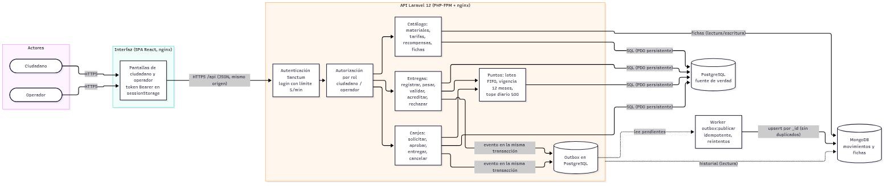
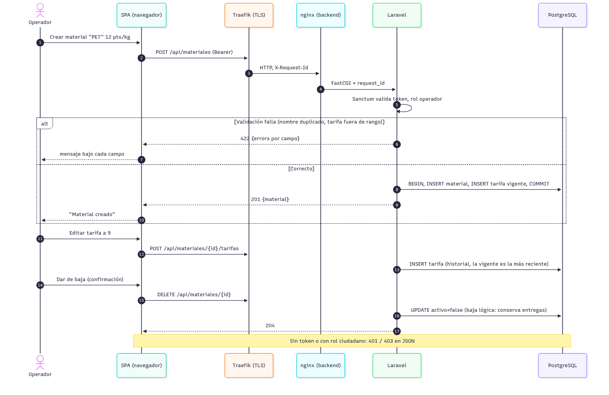
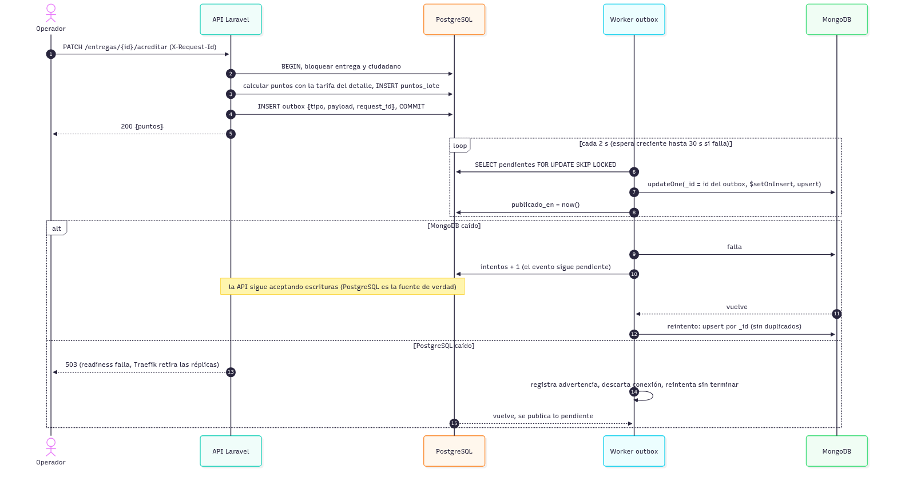
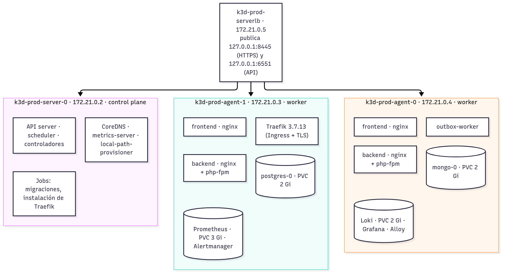
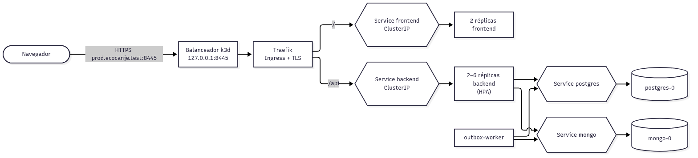
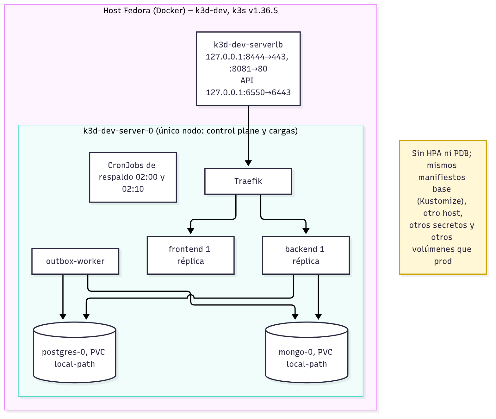
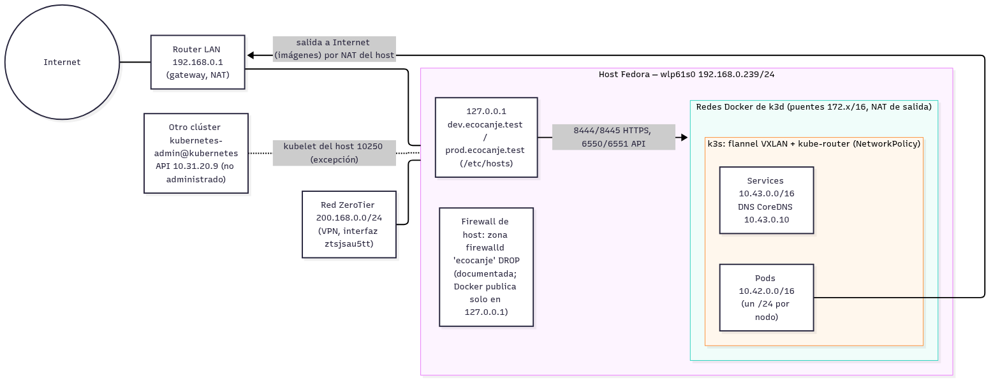

# D03. Diagramas, inventario y presupuesto de capacidad

Los diagramas son editables en [`docs/diagramas/`](../diagramas/) (Mermaid, texto plano); las imágenes se generan con
`scripts/informe.sh`.

## Arquitectura de la aplicación

**Recorrido de referencia** (SPA en el mismo origen): navegador → `127.0.0.1:8445` (balanceador de k3d) →
Traefik (TLS, Ingress) → `/` Service `frontend` → réplicas nginx con la SPA; las llamadas de la SPA van a `/api` →
Service `backend` → réplicas nginx + PHP-FPM → Services internos `postgres` y `mongo`. El navegador nunca llega a las
bases: no tienen ruta de Ingress, su Service es `ClusterIP` y las NetworkPolicy solo admiten a los clientes etiquetados
(E08). Se eligió SPA porque toda la lógica y la autorización ya están en la API; el frontend es estático y escala sin
estado.

## Secuencias

CRUD de materiales (validación, alta, cambio de tarifa y baja lógica):

Flujo que usa ambos motores, con errores y recuperación:

## Implementación por ambiente

Ubicación de cada componente por nodo (observada el 2026-11-06; los componentes de una réplica los ubica el
scheduler y pueden cambiar al recrear el clúster, salvo las bases, atadas al nodo de su volumen):

Flujo lógico en producción: el Ingress publica, los Services reparten entre réplicas dentro del clúster:

| Objeto | dev | prod |
|---|---|---|
| Nodos | 1 (server, también corre cargas) | 1 server (control plane) + 2 workers; cargas de la app y Traefik en workers |
| backend / frontend | 1 / 1 réplica | 2–6 (HPA, CPU 60 %) / 2, una por worker (`topologySpreadConstraints`, `nodeTaintsPolicy: Honor`, `matchLabelKeys`) |
| outbox-worker | 1 | 1 |
| Bases | StatefulSets postgres-0 y mongo-0, PVC `local-path` 2 Gi c/u | igual, en workers distintos |
| Respaldos | CronJobs 02:00 y 02:10, PVC `respaldos` | igual; exportación cifrada fuera del clúster |
| PDB | — | backend y frontend `minAvailable: 1` |
| Observabilidad | — | Prometheus (PVC 3 Gi), Alertmanager, Grafana, kube-state-metrics, node-exporter, exportadores de ambas bases, Loki (PVC 2 Gi), Alloy |

## Comunicación

| Elemento | dev | prod | Notas |
|---|---|---|---|
| Red Docker del clúster | 172.20.0.0/16 (gw .1) | 172.21.0.0/16 (gw .1) | puentes de Docker, NAT de salida del host |
| Nodos | server-0 172.20.0.2, serverlb .3 | server-0 172.21.0.2, agent-1 .3, agent-0 .4, serverlb .5 | las IP de los agentes pueden cambiar al reiniciar el host (incidente E11) |
| CIDR de Pods | 10.42.0.0/24 | 10.42.0.0/24 (server), 10.42.1.0/24 (agent-1), 10.42.2.0/24 (agent-0) | flannel VXLAN |
| CIDR de Services | 10.43.0.0/16 | 10.43.0.0/16 | DNS CoreDNS 10.43.0.10 |
| Publicación | 127.0.0.1:8444 (HTTPS), :8081, API :6550 | 127.0.0.1:8445 (HTTPS), :8082, API :6551 | solo loopback (E08 `tests/exposicion.sh`) |
| Nombre | dev.ecocanje.test | prod.ecocanje.test | `/etc/hosts` del host |

Rangos del host: LAN 192.168.0.0/24 (wlp61s0, gateway 192.168.0.1), VPN ZeroTier 200.168.0.0/24 (ztsjsau5tt) y la red
del otro clúster 10.31.0.0/16. No se solapan con los rangos de Pods (10.42/16), Services (10.43/16) ni las redes de
Docker (172.17–172.21/16). Los clústeres son independientes: mismos rangos internos, pero redes Docker, nodos,
credenciales y volúmenes distintos (`tests/independencia.sh`).

## Inventario

| Recurso | Valor |
|---|---|
| Equipo | Laptop, Intel Core i7-8650U a 1.90 GHz, x86_64, 4 núcleos / 8 hilos |
| Memoria | 23 GiB |
| Disco | NVMe, partición raíz 200 GB (139 GB libres) |
| Sistema | Fedora Linux 44 Workstation, kernel 7.2.15 |
| Contenedores | Docker 29.9.3; k3d con k3s v1.36.5 |
| IP | 192.168.0.239/24 (Wi-Fi), 200.168.0.179/24 (ZeroTier) |

**Aislamiento y capacidad compartida.** Cada nodo de k3d declara como asignables los 8 CPU y 23 GiB del host completo;
los tres nodos de prod y el de dev compiten por el mismo procesador, memoria y disco. Kubernetes no lo sabe: el
presupuesto real es el del host. Una falla del host detiene ambos ambientes.

## Presupuesto de capacidad (medido el 2026-11-06)

Requests y límites declarados en reposo:

| Ambiente | Pods | Requests CPU | Requests memoria | Límites CPU | Límites memoria |
|---|---|---|---|---|---|
| dev | 10 | 0.58 | 876 Mi | 3.05 | 2.6 Gi |
| prod: ecocanje | 9 | 0.53 | 952 Mi | 4.35 | 3.1 Gi |
| prod: monitoring | 7 | 0.27 | 1074 Mi | 2.70 | 2.7 Gi |
| prod: monitoring-nodos | 3 | 0.03 | 72 Mi | 0.60 | 192 Mi |
| prod: kube-system | 7 | 0.20 | 140 Mi | — | 170 Mi |
| **prod total** | 26 | 1.03 | 2.2 Gi | 7.65 | 6.2 Gi |

Consumo real de prod en reposo: ~1.3 cores y ~3.2 GiB entre los tres nodos. Cuota del namespace `ecocanje`:
requests 4 CPU / 6 Gi, límites 8 CPU / 10 Gi, 40 Pods, 6 PVC, 20 Gi de almacenamiento.

**Con el HPA al máximo (6 réplicas de backend)**: +4 × (120m requests, 700m límites) → límites de CPU de `ecocanje`
7.15 de 8. Bajo la carga de E06 el host llegó a 63 % de CPU y el backend a 2.97 cores con 89 % de throttling: el
siguiente límite es la CPU de los Pods y del propio host, no la cuota. **Restricción operativa:** si el HPA está en 6,
el Job de migraciones (límite 1 CPU) excedería la cuota de límites (8.15 > 8) y no se crearía; no desplegar con el HPA al
máximo, o subir la cuota.

**Cuando ya no caben réplicas.** El HPA crea Pods, no máquinas: con 6 réplicas se alcanza `maxReplicas`; si la cuota o
la memoria del host se agotan antes, los Pods nuevos quedan en Pending (visibles en el panel y en
`kube_pod_status_phase`). El crecimiento real requeriría más hosts o un host mayor.

## Puntos únicos de fallo

| Componente | Consecuencia | Mitigación posible |
|---|---|---|
| Host físico | ambos ambientes caen | segundo host o nube |
| Control plane único (server-0) | sin cambios ni reprogramación; las cargas siguen | k3s con 3 servers (etcd embebido) |
| Balanceador de k3d (serverlb) | sin entrada externa | balanceador redundante |
| PostgreSQL y MongoDB (1 réplica, volumen local) | sin servicio (PG) o historial retrasado (Mongo) | réplicas del motor y almacenamiento replicado |
| Monitoreo en los mismos workers | ciego si caen los workers | Prometheus fuera del clúster o en otro clúster |
