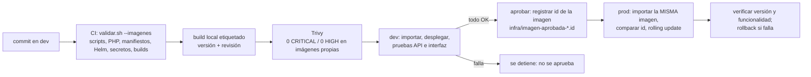

# D07. Publicación, promoción, actualización, rollback y accesos

## Ciclo de una versión

- **Artefacto inmutable.** La imagen que llega a prod es la misma que se probó en dev: `verificar-imagen.sh` compara el
  id de la imagen en cada nodo con el registrado al aprobar; si difiere, la promoción se detiene.
- **Solo cambia la configuración del ambiente.** Las diferencias entre dev y prod viven en `infra/dev` e `infra/prod`
  (réplicas, HPA, PDB, reparto, host); la imagen y la base son las mismas.
- **Sin registro de imágenes.** En el laboratorio las imágenes se importan con `k3d image import`
  (`imagePullPolicy: IfNotPresent`); en un entorno real se publicarían por digest en un registro privado.

## Procedimientos

| Tarea | Comando | Compuertas |
|---|---|---|
| Promover el backend | `scripts/actualizacion.sh prod <nueva> <anterior>` | imagen aprobada; versión y prueba de roles en cada fase; sonda HTTPS sin errores |
| Promover el frontend | `scripts/promover-frontend.sh <versión>` | Trivy 0/0; prueba de interfaz en dev antes de aprobar; misma imagen en prod; prueba de interfaz en prod |
| Desplegar un ambiente | `scripts/desplegar.sh <dev\|prod>` | recrea el Job `migraciones`; espera su éxito y el rollout |
| Rollback de imagen | `kubectl -n ecocanje rollout undo deploy/backend deploy/outbox-worker` (o `deploy/frontend`) y después restaurar el estado declarado en Git | prueba de versión y funcionalidad |

La actualización es gradual (`maxSurge: 1`, `maxUnavailable: 0`), con readiness que valida PostgreSQL y `preStop` de
5 s para que el Pod saliente siga atendiendo mientras se retira de los endpoints. Sin ese `preStop` se perdían 3
solicitudes por fase (E12, primer intento); con él, 0.

## Migraciones y rollback

Un rollback de imagen **no** revierte el esquema. Política: cada migración debe ser compatible con la versión anterior
de la aplicación (solo aditiva: tablas o columnas nuevas, nulas o con valor por defecto). Un cambio destructivo se hace
en dos versiones: primero se deja de usar la columna, después se elimina. Si una migración no es compatible, su plan de
reversión es `php artisan migrate:rollback --step=1` (todas tienen `down()`) ejecutado como Job con la cuenta
`ecocanje_migrador` **antes** del `rollout undo`, previo respaldo (`scripts/respaldar.sh prod`). Entre 0.1.1 y 0.1.3
no hubo cambios de esquema.

## Historial de versiones

| Imagen | Versión | Cambio | Aprobada |
|---|---|---|---|
| backend | 0.1.1 | imagen construida el 2 nov desde la revisión `978939b` y desplegada en dev y prod (la 0.1.0, del 27 oct, introdujo la imagen de producción y los endpoints de salud) | id `ac2590b7b87d3` |
| backend | 0.1.2 | conexiones persistentes a PostgreSQL; versión visible; caché de rutas y eventos | `94410517655dd` |
| backend | 0.1.3 | correlación `X-Request-Id`; worker resiliente; sin N+1; 401 en JSON; desempate de tarifas | `41f344a148ebb` |
| frontend | 0.1.0 | SPA inicial | `6451729c69f9b` |
| frontend | 0.1.1 | `apk upgrade` (brotli, CVE crítico) | `ba0a23b71c651` |
| frontend | 0.1.2 | validación en el navegador; búsqueda por ciudadano | `453c385884cdc` |
| frontend | 0.1.3 | descarta respuestas de consultas no vigentes | `79b8fa604e6dd` |
| frontend | 0.1.4 | un 401 tardío ya no cierra una sesión nueva | `06cef4d5cff81` |

Pruebas de actualización y rollback: 0.1.1 → 0.1.2 → 0.1.1 → 0.1.2 y 0.1.2 → 0.1.3 → 0.1.2 → 0.1.3, ambas con 0
errores en la sonda (E12). En la segunda, la prueba de roles falla justo en las fases con 0.1.2 por el defecto del 401
corregido en 0.1.3: confirma que el rollback restauró el comportamiento anterior.

**Lección de procedimiento.** El frontend 0.1.3 se promovió a prod aunque su prueba de interfaz en dev había fallado:
la cadena de comandos filtraba la salida con `grep` y ocultó el código de salida (anotado en la evidencia DEP05). Desde
entonces la promoción usa `promover-frontend.sh`, donde cada paso es una compuerta (`set -euo pipefail`).

## Administración de accesos

| Tarea | Procedimiento |
|---|---|
| Alta | `scripts/crear-usuario.sh <amb> <usuario> <lectura\|despliegue\|operaciones>`; entregar el kubeconfig por un canal seguro |
| Cambio de función | emitir un certificado nuevo con la otra función; el anterior vence en 30 días |
| Baja inmediata | quitar el grupo del RoleBinding (afecta a todos los de esa función) o recrear la CA del clúster; en un entorno real, OIDC |
| Revisión | `kubectl get csr`; `kubectl auth can-i --list --as=<usuario> --as-group=ecocanje:<función> -n ecocanje` |
| Administrador | kubeconfig de k3d en `~/.kube/config` (permisos 600); solo el propietario del equipo |
| Aplicación | usuarios en la base (rol `ciudadano` u `operador`); el alta de operadores se hace por semilla o por el administrador de la base |
